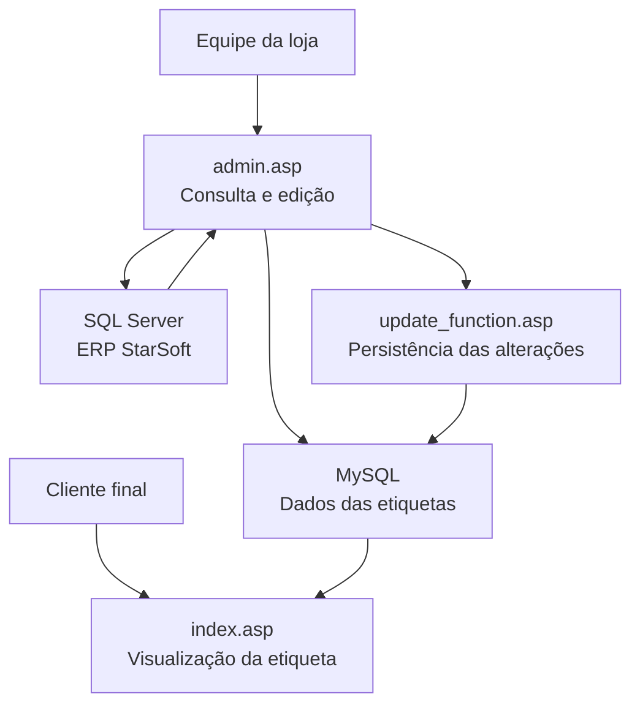

<h1 align="center">🏷️ Etiqueta de Produto</h1>

  Sistema de consulta e gerenciamento de etiquetas de produtos, com integração entre banco de etiquetas MySQL e ERP StarSoft (SQL Server).

  
  
  
  
  

## 📑 Sumário

- [💻 Sobre o projeto](#-sobre-o-projeto)
- [🧩 Estrutura do repositório](#-estrutura-do-repositório)
- [⚙️ Funcionalidades e fluxo](#️-funcionalidades-e-fluxo)
- [🗄️ Integração com bancos de dados](#️-integração-com-bancos-de-dados)
- [🛠️ Tecnologias](#️-tecnologias)
- [🚀 Execução e pré-requisitos](#-execução-e-pré-requisitos)
- [🔐 Segurança e observações](#-segurança-e-observações)
- [🦸🏻‍♂️ Autor](#️-autor)
- [📝 Licença](#-licença)

## 💻 Sobre o projeto

O **Etiqueta de Produto** é uma solução desenvolvida para apoiar a apresentação de informações de produtos e a manutenção dos dados utilizados nas etiquetas da **Brentwood**.

A aplicação reúne uma **visão destinada ao cliente final**, uma **área administrativa utilizada pela loja** e uma **rotina responsável por persistir atualizações no banco de dados**. A solução também consulta informações do **ERP StarSoft**, permitindo comparar valores cadastrados nas etiquetas com valores calculados a partir de dados do ERP.

### Objetivos

- Disponibilizar a visualização das etiquetas e informações dos produtos.
- Permitir que a equipe da loja consulte e edite dados associados às etiquetas.
- Consultar preços de referência do ERP StarSoft e identificar divergências.
- Atualizar valores selecionados no banco de etiquetas.
- Reduzir a necessidade de manutenção manual e desconectada entre sistemas.

## 🧩 Estrutura do repositório

| Arquivo | Responsabilidade |
| --- | --- |
| [`index.asp`](./index.asp) | **Visão do cliente final:** página associada à apresentação da etiqueta e à consulta das informações do produto. |
| [`admin.asp`](./admin.asp) | **Administração da loja:** interface para consultar etiquetas, comparar valores com o StarSoft e preparar alterações nos dados. |
| [`update_function.asp`](./update_function.asp) | **Atualização do banco:** rotina de processamento dos dados recebidos por formulário e execução de comandos `UPDATE` no MySQL. |
| [`LICENSE`](./LICENSE) | Termos da licença do projeto. |

## ⚙️ Funcionalidades e fluxo

### 🏷️ Visualização da etiqueta — `index.asp`

Camada destinada à experiência do cliente final, com acesso às informações associadas à etiqueta do produto.

### 🧑‍💻 Gerenciamento administrativo — `admin.asp`

O código disponibilizado implementa recursos de:

- Pesquisa por **número de etiqueta**, **fornecedor** e **descrição do produto**.
- Consulta de produtos ativos cadastrados na tabela `D41`.
- Comparação entre o **valor da etiqueta** e o **valor obtido no StarSoft**.
- Cálculo da **variação percentual** entre os valores.
- Consulta de valores de itens vinculados à informação de **item mínimo**.
- Seleção e preparação dos registros que serão atualizados.

### 🔄 Persistência de alterações — `update_function.asp`

Rotina responsável por:

- Receber valores enviados por formulário.
- Identificar os registros selecionados.
- Validar o formato do valor mínimo com expressão regular.
- Executar `UPDATE` sobre a tabela `D41`, alterando os campos `VALOR`, `VALORCOMPLEMENTO` e `VALORMINIMO`.
- Apresentar retorno da operação ao usuário.

### Fluxo lógico

O diagrama representa a **organização funcional esperada** do projeto, não necessariamente as chamadas diretas entre arquivos na versão atual do repositório.

## 🗄️ Integração com bancos de dados

A aplicação utiliza **ADO (`ADODB.Connection`)** e drivers de conexão para acessar fontes distintas:

| Origem | Tecnologia | Finalidade |
| --- | --- | --- |
| Banco de etiquetas | MySQL via ODBC | Consulta e atualização de produtos e valores de etiquetas. |
| ERP StarSoft | Microsoft SQL Server | Consulta de referências, componentes do cálculo e preços de produtos. |
| Intranet corporativa | Microsoft SQL Server | Consulta de informações relacionadas ao contexto do usuário e menus internos. |

### Dados de etiquetas

A tabela `D41` contém informações usadas nos processos de consulta e atualização, incluindo:

- `D41_001_C`: identificação da etiqueta.
- `D04_008_C`: descrição do produto.
- `A08_001_C` e `A08_002_C`: identificação e descrição do fornecedor.
- `VALOR`: valor principal da etiqueta.
- `VALORCOMPLEMENTO`: valor complementar.
- `VALORMINIMO`: valor mínimo cadastrado.
- `ITEMVALORMINIMO`: referência utilizada na consulta do item mínimo.
- `ATIVO` e `CONJUNTO`: campos utilizados para filtragem dos registros.

### Consulta ao StarSoft

A interface administrativa realiza consultas ao SQL Server para obter e calcular valores relacionados aos produtos, utilizando informações do catálogo e regras de composição de preço. O resultado é comparado ao valor já cadastrado no banco de etiquetas, apoiando a conferência antes da atualização.

## 🛠️ Tecnologias

- **ASP Clássico e VBScript:** processamento das páginas no servidor.
- **HTML, CSS e JavaScript:** estrutura, apresentação e interações dos formulários.
- **Microsoft SQL Server:** consultas ao ERP StarSoft e à intranet.
- **MySQL:** armazenamento dos dados das etiquetas.
- **ADO / OLE DB / ODBC:** acesso aos bancos relacionais.
- **SQL:** consultas, filtros, cálculos e atualização de registros.

## 🚀 Execução e pré-requisitos

Este repositório contém páginas **ASP Clássico**, que dependem de um ambiente de hospedagem compatível. Para uma implantação funcional, são necessários:

1. Servidor web com suporte a **Classic ASP**, como **IIS no Windows**.
2. Acesso configurado às bases de dados **MySQL** e **SQL Server**.
3. Drivers e provedores de conexão compatíveis com o ambiente.
4. Configuração segura de credenciais e permissões de banco.
5. Disponibilidade das páginas e dependências auxiliares utilizadas pela instalação original.

**Importante:** o repositório não inclui toda a infraestrutura e todas as páginas auxiliares da instalação corporativa. Portanto, a simples cópia desses arquivos para um servidor não garante o funcionamento integral da aplicação.

## 🔐 Segurança e observações

O projeto foi desenvolvido para uso em um ambiente corporativo específico. Antes de disponibilizá-lo em outro ambiente, é necessário revisar:

- Credenciais e strings de conexão, removendo segredos do código-fonte.
- Autorização e autenticação nas rotinas administrativas e de atualização.
- Parametrização das consultas SQL e validação dos dados de entrada.
- Dependências de URLs, páginas auxiliares e recursos internos.
- Tratamento de erros e segurança das operações de atualização.

> **Atenção:** a versão publicada contém uma string de conexão com credenciais embutidas em arquivos ASP. Recomenda-se **revogar ou rotacionar as credenciais expostas**, retirar os segredos do histórico do repositório e mantê-los fora do código versionado.

## 🦸🏻‍♂️ Autor

**Christopher Silva**

## 📝 Licença

Distribuído sob a licença **MIT**. Consulte o arquivo [LICENSE](./LICENSE) para mais informações.

---

Desenvolvido por **Christopher Silva**.
